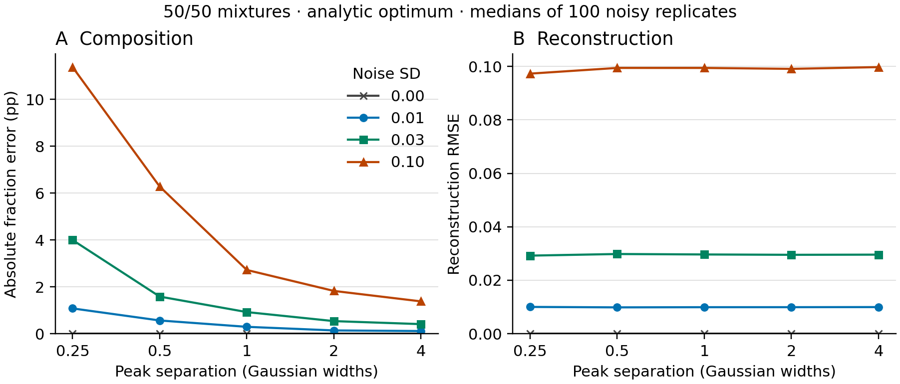

# When Spectra Overlap

A reproducible numerical benchmark for estimating the composition of two-component spectral mixtures. In simulated 50/50 mixtures with noise SD 0.10, median absolute composition error was **11.38 percentage points** at 0.25 peak widths of separation and **1.38 points** at four widths. Median spectral reconstruction RMSE was approximately 0.10 at both separations.



## Reproduce

From the repository root, with Python 3.12 and uv available:

```bash
uv run --locked pytest -q
uv run --locked python -m spectral_benchmark --output results/run-1
```

Choose a new output directory for each run. The environment is specified by `uv.lock`. After dependency installation, add `--offline` to either command to use the existing environment without network access. The simulation generates its inputs from a recorded seed.

| Output | Contents |
| --- | --- |
| `observations.csv` | One row per mixture and solver, with the estimate, analytic optimum, errors and solver diagnostics |
| `summary.csv` | Medians, 90th percentiles and failure counts by condition and method |
| `figure.png` | Two-panel figure for 50/50 mixtures |
| `manifest.json` | Runtime, dimensions, package versions, Git revision and source hashes |

## Evidence

- [Scientific report](REPORT.md) and [frozen experimental protocol](PROTOCOL.md).
- [Per-fit results](results/validated/observations.csv) and [condition summaries](results/validated/summary.csv).
- [Reproduction evidence](results/validated/reproduction.json) records matching table hashes and the two execution manifests.

The code is available under the [MIT license](LICENSE). Cite the version using [CITATION.cff](CITATION.cff).
