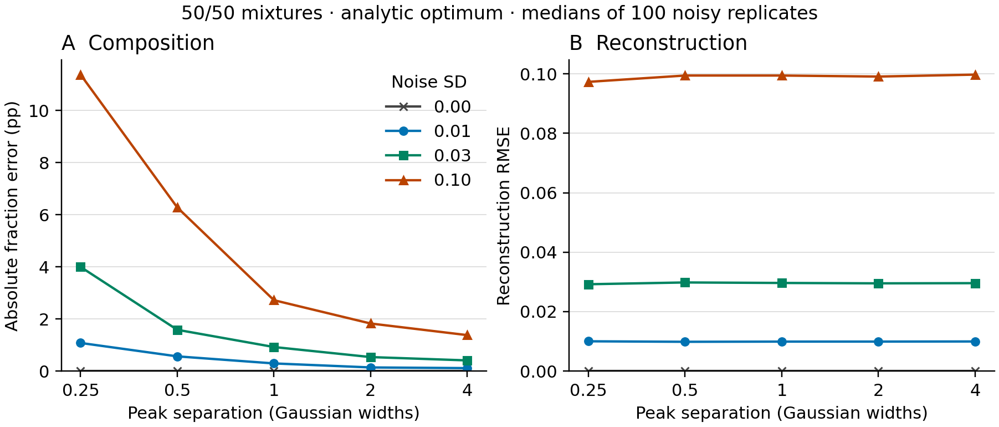

# When Spectra Overlap
## Composition error and reconstruction error in a two-component simulation

**Marcos Cabral Netto**

For 50/50 mixtures at noise SD 0.10, the median absolute error in estimating composition fell from **11.38 to 1.38 percentage points** as the peak separation increased from 0.25 to 4 Gaussian widths. Median reconstruction RMSE moved from **0.0973 to 0.0997** in peak-amplitude units. In this experiment, a reconstruction residual near the measurement noise can coexist with substantial uncertainty in composition.

**Figure 1.** Median errors at the analytic optimum for mixtures containing equal proportions. Each point at nonzero noise summarizes 100 independent replicates. Each zero-noise point represents one deterministic observation. Lines connect the tested separations. Percentiles and results for the other proportions are in the [condition table](results/validated/summary.csv).

## Methods

We sampled two unit-amplitude Gaussian reference spectra on 121 equally spaced points with width σ = 6. Their centers were placed symmetrically about zero. The 100 conditions cross five separations, five known compositions and four levels of additive independent Gaussian noise. The full design comprises 7,525 mixtures. Both solvers received the same realization for each mixture. The design, tolerances and PCG64 seed were committed in the [experimental protocol](PROTOCOL.md) before the complete analysis.

For observation y and spectra s₁ and s₂, the predicted signal is s₂ + p(s₁ − s₂), with p between zero and one. BVLS and SLSQP minimize the same squared residual. We separately calculated the analytic optimum by projecting the observation onto the line segment between the spectra. We measured absolute error relative to the known fraction and reconstructed-signal RMSE relative to the observed spectrum. The absolute difference from the analytic optimum measures numerical agreement.

## Results and numerical validation

| Peak separation (σ) | Median composition error (pp) | 90th percentile (pp) | Median reconstruction RMSE |
| ---: | ---: | ---: | ---: |
| 0.25 | 11.38 | 32.48 | 0.0973 |
| 0.50 | 6.28 | 16.59 | 0.0994 |
| 1.00 | 2.72 | 8.21 | 0.0994 |
| 2.00 | 1.83 | 4.11 | 0.0991 |
| 4.00 | 1.38 | 4.37 | 0.0997 |

The table uses the 50/50 mixtures and noise SD 0.10. The median falls across the five separations. The empirical 90th percentile rises slightly from 2σ to 4σ in this finite simulation.

| Solver | Fits | Failed | Maximum difference from optimum | Maximum noiseless fraction error |
| --- | ---: | ---: | ---: | ---: |
| BVLS | 7,525 | 0 | 7.77 × 10⁻¹⁶ | 4.44 × 10⁻¹⁶ |
| SLSQP | 7,525 | 0 | 2.91 × 10⁻¹² | 1.48 × 10⁻¹² |

Solver differences are in fraction units. All estimates were feasible within the prespecified tolerance. Two local runs, including one from a clean clone, produced byte-identical observation and summary tables. Command runtimes were 3.88 and 4.16 seconds within the analysis process on the recorded WSL environment. Both runs used the same Python and package versions. [Reproduction record](results/validated/reproduction.json)

## Interpretation and limits

The unclipped fraction error is the projection of the noise onto s₁ − s₂ divided by the squared length of that difference vector. Its standard deviation is the noise SD divided by ‖s₁ − s₂‖₂. That length increased from 0.574 to 4.569 across the extreme separations. Clipping at zero or one changes the error distribution near the bounds. The spectral residual measures the noise left after adjustment along one direction, so it can remain close to the original noise level while uncertainty along that direction grows.

The experiment assumes two exactly known, equal-width Gaussian reference spectra and additive independent Gaussian noise. It does not model uncertain references, correlated noise, background drift or additional components. The percentiles describe the simulated replicates under each condition. The runtime figures describe reproduction on one environment, and solver accuracy was assessed only on the single-parameter problem defined here.

## References

- [SciPy documentation for bounded linear least squares](https://docs.scipy.org/doc/scipy/reference/generated/scipy.optimize.lsq_linear.html)
- [SciPy documentation for SLSQP](https://docs.scipy.org/doc/scipy/reference/optimize.minimize-slsqp.html)
- [Paired airway RNA-seq agent task, the model for the structure and reproduction evidence](https://github.com/marcosjcn94-bit/rnaseq-agent-task)
- [Kassis et al. (2026), Scientific Agent Skills, consulted for figure design and review](https://doi.org/10.48550/arXiv.2609.00065)
